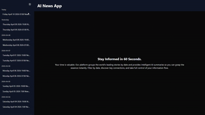

# AI News Summaries Platform

A Dockerized full-stack application that automatically generates concise AI-powered news summaries twice a day and serves them through a REST API and a modern frontend interface.

---

## Demo

Below is a quick demo of the application in action:



---

## Try It Out

Requires Docker and Docker Compose.

```bash
# Get repo
git clone https://github.com/chrisbgvt/ai-summary-project.git
cd ai-summary-project
cp backend/.env.example backend/.env
cp frontend/.env.example frontend/.env

# For production
docker compose -f docker-compose.yml up

# For dev
docker compose up
```

Add \`-d\` to either command to run in the background once everything's confirmed working.

---

## Architecture

* Multi-stage Docker builds for both backend and frontend, with separate 
  dev (hot-reload) and prod (optimized) targets
* Health-checked service startup — dependent services wait for MySQL/Redis 
  to be truly ready
* Dedicated one-shot migration service, so migrations run exactly once

---

## AI Model

The system uses:

```
sshleifer/distilbart-cnn-12-6
```

A lightweight transformer model optimized for abstractive summarization.

---

## Backend (Laravel API)

The backend is responsible for:

* Storing generated summaries
* Serving API endpoints with caching powered by Redis
* Running scheduled jobs
* Executing the Python summarization and eval scripts - backend/scripts/

## Frontend (Next.js)

Features:

* News summaries list with pagination and filter by date
* Individual summary detail page
* Sidebar with summaries grouped by last 7 days
* Fast and responsive UI with Tailwind CSS and shadcn/ui

---

## License

This project is open-source and available under the MIT License.
